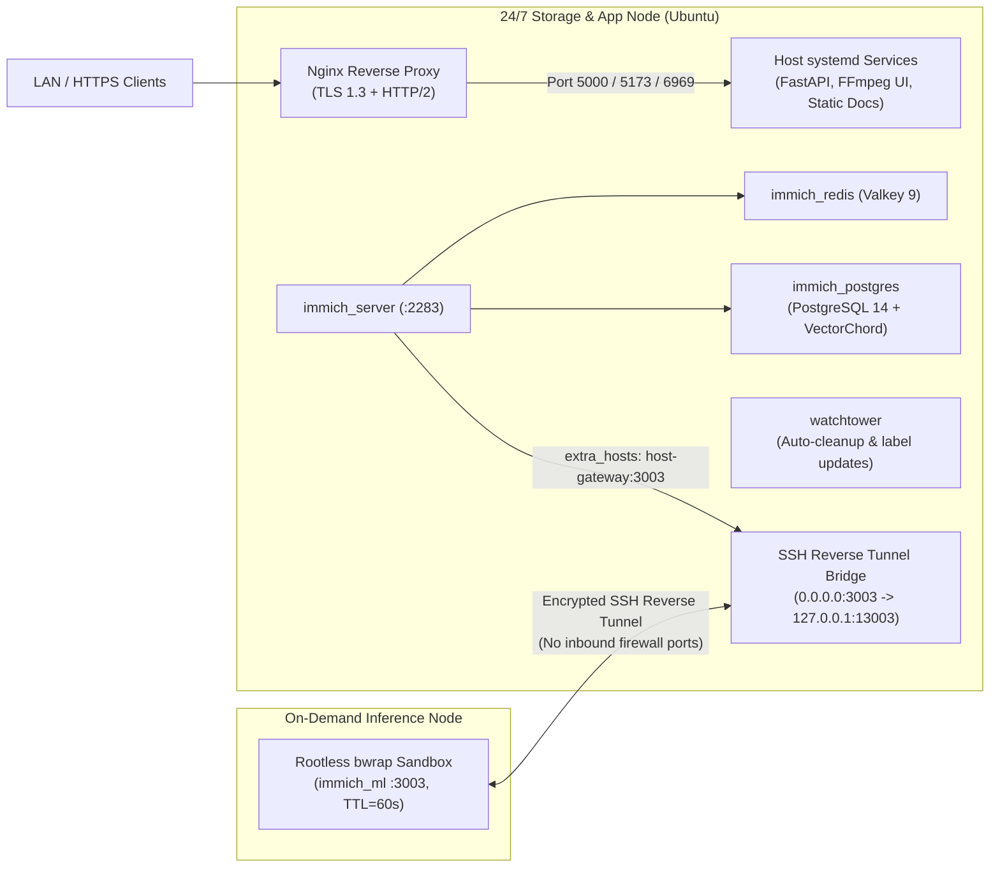

# Homelab Infrastructure (IaC & Hybrid Distributed ML)

[](https://github.com/noocklasss/homelab-infrastructure/actions/workflows/ci.yml)

Production-oriented Infrastructure as Code (IaC), reverse proxy configurations, `systemd` service definitions, and operational automation for a hybrid two-node self-hosted homelab.

---

## Overview & Motivation

This repository manages a self-hosted Linux environment designed to maximize reliability and hardware reuse across two distinct nodes:

- **Storage & Always-On Node (`oikoserver`)**: An older low-power Ubuntu server (**Intel Core 2 Duo T6570**, **2.8 GiB RAM**) running 24/7 for photo management (**Immich**), **PostgreSQL + VectorChord**, **Valkey**, **Nginx TLS 1.3** reverse proxying, **Samba** file sharing, and local microservices.
- **On-Demand AI Inference Node (`noock`)**: A modern workstation (**12th Gen Intel i5-12400**, **RTX 2060**) running a rootless, sandboxed **Immich Machine Learning** worker over an encrypted **SSH reverse tunnel** so heavy neural network inference never impacts the 24/7 node.

---

## System Architecture



---

## Engineering Case Study: Overcoming Legacy CPU ISA Limits (`x86_64-v2`)

### The Problem
The 24/7 storage server runs on a 2009 **Intel Core 2 Duo T6570** (up to SSE4.1) with **2.8 GiB RAM**. Starting with Immich `v3`, the official `immich-machine-learning` container ships **NumPy 2.x** compiled with `-march=x86-64-v2` (SSE4.2) baseline optimizations, causing an immediate crash loop on startup:

```text
RuntimeError: NumPy was built with baseline optimizations:
(X86_V2) but your machine doesn't support:
(X86_V2).
```

### The Solution
Rather than pinning legacy software or leaving a desktop running 24/7:
1. **Decoupled Stateful & Stateless Services**: Removed `immich-machine-learning` from the server's Docker Compose stack while keeping `immich_server`, `immich_postgres` (VectorChord), and `immich_redis` (Valkey 9) online 24/7.
2. **Rootless Sandboxed Worker (`bubblewrap`)**: Exported the official `v3.4.1` OCI container rootfs to the workstation and executed `/opt/venv/bin/python -m immich_ml` inside an unprivileged `bwrap` namespace (`remote-ml-worker/bin/immich-ml`) managed by `systemd --user`.
3. **Zero Idle Footprint**: Configured `MACHINE_LEARNING_MODEL_TTL=60` so CLIP and facial recognition models unload completely from RAM 60 seconds after a search or photo upload finishes.
4. **Firewall-Friendly SSH Reverse Tunnel**: `remote-ml-worker/bin/immich-ml-tunnel` maintains an auto-reconnecting outbound SSH tunnel to the server (`ServerAliveInterval=15`), bridging `host-gateway:3003` directly into `immich_server` via Docker's `extra_hosts` without opening inbound ports on the workstation's `ufw` firewall or enabling `GatewayPorts` in `sshd`.

See [remote-ml-worker/README.md](remote-ml-worker/README.md) for full setup details.

---

## Repository Structure

```text
.
├── .github/workflows/
│   └── ci.yml                       # ShellCheck linting, Compose validation, & secret leak guard
├── remote-ml-worker/
│   ├── bin/
│   │   ├── immich-ml                # Rootless bubblewrap launcher for Immich ML v3
│   │   └── immich-ml-tunnel         # Persistent SSH reverse tunnel + asyncio port bridge
│   ├── systemd/
│   │   ├── immich-ml.service        # systemd --user unit for the ML sandbox
│   │   └── immich-ml-tunnel.service # systemd --user unit for the SSH tunnel
│   └── README.md                    # Technical deep-dive on CPU ISA & ML offloading
├── reverse-proxy/nginx/
│   ├── media-api.conf               # TLS 1.3 + HTTP/2 reverse proxy for FastAPI service
│   ├── media-transcoder.conf        # TLS 1.3 + WebSocket upgrade proxy (1G upload limit)
│   └── static-docs.conf             # HTTP reverse proxy for local documentation mirror
├── scripts/
│   ├── backup-postgres.sh           # Compressed pg_dumpall backup with 7-day retention pruning
│   ├── duckdns-update.sh            # Environment-driven dynamic DNS updater
│   └── healthcheck.sh               # End-to-end verification of Immich API & ML tunnel
├── stacks/
│   ├── immich/
│   │   ├── .env.example             # Sanitized environment variable template
│   │   └── docker-compose.yml       # Immich v3 server, VectorChord PostgreSQL, & Valkey 9
│   └── maintenance/
│       └── docker-compose.yml       # Watchtower automated cleanup & label-scoped updates
├── systemd/
│   ├── ffmpeg-ui.service            # FFmpeg Web UI host service
│   ├── media-api.service            # Uvicorn FastAPI media service
│   └── static-docs.service          # Node.js static documentation service
├── .gitignore
└── LICENSE
```

---

## Security & Secret Management

- **No committed credentials**: Real `.env` files, TLS certificates (`*.pem`, `*.key`, `*.crt`), database dumps, and runtime volumes are strictly excluded via `.gitignore` and enforced by CI.
- **TLS 1.3 termination**: Public-facing Nginx virtual hosts enforce `ssl_protocols TLSv1.3` with `HTTP/2`.
- **Least-privilege isolation**:
  - Host `systemd` services run under a dedicated non-root user and bind internal backends to `127.0.0.1` behind Nginx.
  - The remote ML worker executes inside an unprivileged `bwrap` filesystem sandbox.
  - Inter-node ML traffic travels exclusively inside an authenticated Ed25519 SSH tunnel.

---

## Operations, Backups & Verification

### 1. Deploy the Immich Stack (Server)
```bash
cd stacks/immich
cp .env.example .env
# Edit .env with strong database credentials and host paths
docker compose up -d
```

### 2. Automated PostgreSQL Backups
`scripts/backup-postgres.sh` performs atomic compressed logical dumps (`pg_dumpall | gzip -9`) and automatically prunes archives older than `RETENTION_DAYS` (default: `7`):
```bash
./scripts/backup-postgres.sh
```

### 3. End-to-End Health Check
Verify the local `bwrap` worker, SSH reverse tunnel, Immich server API version, and container-to-worker routing in one command:
```bash
./scripts/healthcheck.sh
```
